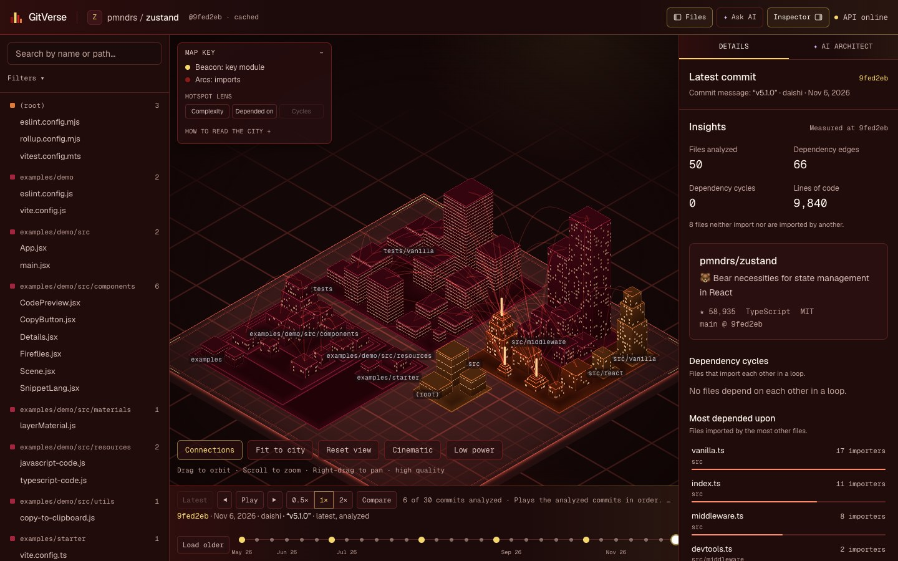
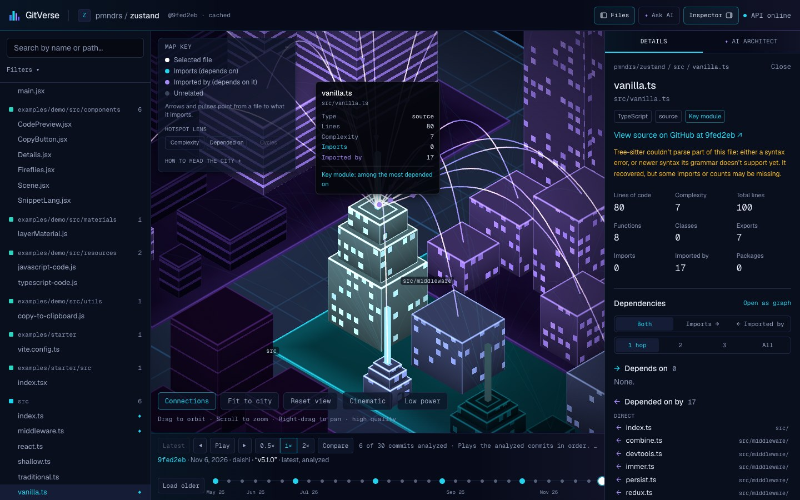
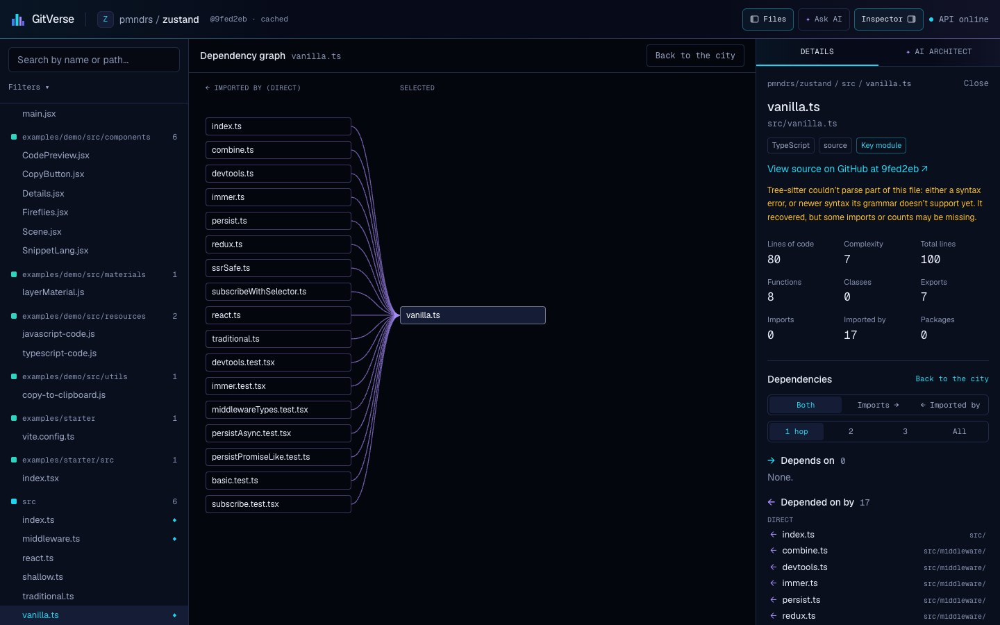
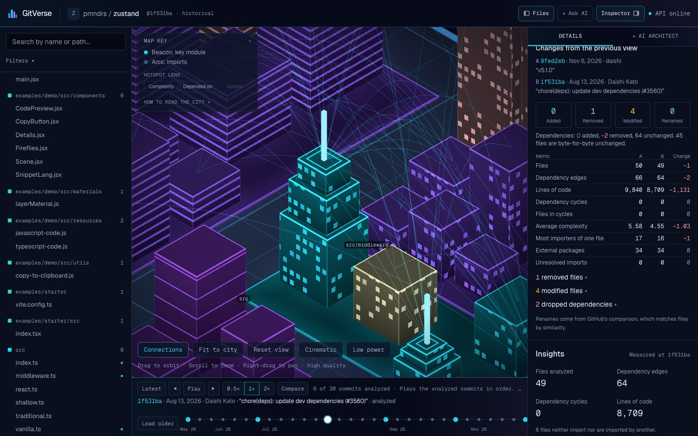
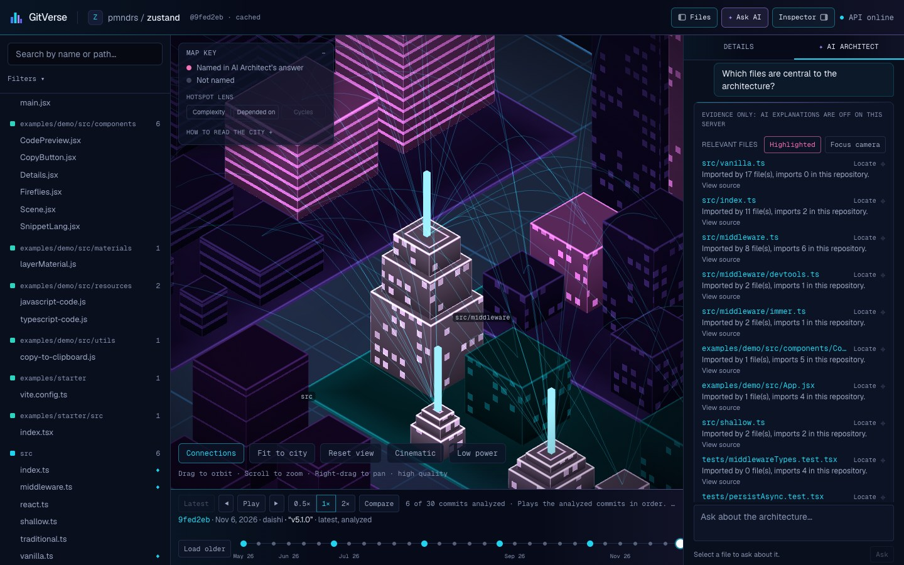
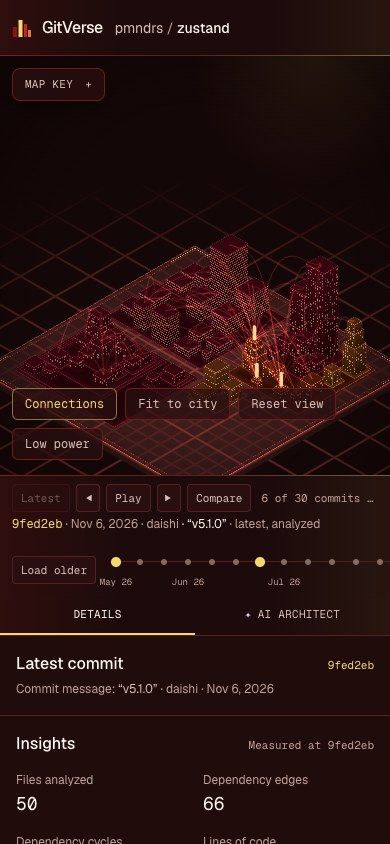
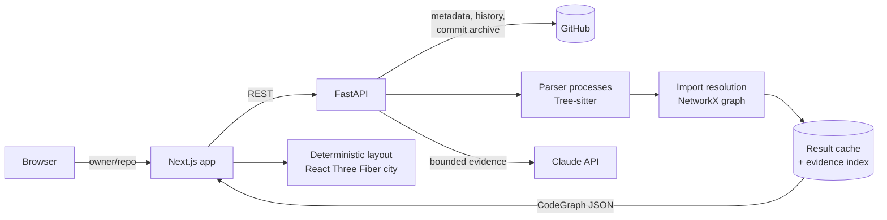

# GitVerse

**Explore Code Like a Universe.**

GitVerse turns a public GitHub repository into an interactive 3D city. Folders become districts,
files become buildings shaped by their size and complexity, and imports become arcs of light
between them. You can trace dependencies, replay the repository's history, and ask an AI
architect questions that are answered from evidence the analysis gathered, with every cited file
and line checked against it.



Every screenshot here is the production build analyzing the real
[pmndrs/zustand](https://github.com/pmndrs/zustand) repository. Nothing is mocked or edited.

## Features

**Real source analysis.** GitVerse downloads one commit's archive, parses every JavaScript and
TypeScript file with [Tree-sitter](https://tree-sitter.github.io/), resolves imports (including
`tsconfig` paths), and builds a dependency graph with NetworkX: cycles, hubs, external packages,
unresolved imports and per-file metrics. Repository code is read as text and never executed.

**A city you can read.** Height is cyclomatic complexity, footprint is lines of code, colour is the
top-level folder, window patterns show the file type, and beacons mark the most depended-upon
modules. The layout is deterministic: the same graph always builds the same city.



**Dependency exploration.** Select a building to trace what it imports and what imports it, from
one hop out to everything reachable. The same traversal is available as a left-to-right graph,
and every file links to its source on GitHub, pinned to the analyzed commit.

| Dependency graph | Hotspot lens |
| --- | --- |
|  |  |

**Architecture insights.** File, edge and cycle counts, the most depended-upon files, the largest
modules, complexity hotspots, and how the code is spread across folders, all counted from the
graph. Hotspot lenses light up the most complex files, the most depended-upon files, or every file
in an import cycle.

**Git Time Travel.** A timeline of the default branch's real history. Representative commits are
analyzed up front and any other on request. Step or play through them and the city animates: new
files rise, removed ones sink, changed ones resize. Compare any two commits to see files and
dependencies added, removed, modified and renamed.



**AI Architect.** Ask questions such as "Where is authentication implemented?", "What depends on
this module?" or "Where could circular dependencies cause problems?". GitVerse first retrieves
bounded evidence itself (files, declarations, import lines, graph facts and short source
excerpts), then asks Claude to answer from it. Each claim is marked verified or inferred and cites
its evidence; files and dependencies that don't exist in the analysis are removed before you see
the answer; line links come only from the analysis. The files an answer names light up in the
city, with buttons to focus the camera and open each file in the inspector.



The screenshot shows **evidence-only mode**, which is what GitVerse does when no Anthropic API
key is configured: the retrieved evidence, ranked and labelled, without a model's explanation.

**Search and navigation.** Search by name or path, filter by folder, language, size, complexity
and importer count, collapse the side panels to give the city the whole screen, and use the
keyboard throughout: `F` fits the city, `R` resets the view, `[` and `]` toggle the panels, `Esc`
clears the selection.

**Works on smaller screens and slower devices.** The layout reorganizes on tablets and phones,
rendering quality adapts to measured frame times, and a low power mode turns off the costlier
effects while keeping every analysis feature. Reduced-motion preferences are respected.



## How it works



1. The backend validates the repository reference against an allowlist, fetches metadata and one
   commit's archive from GitHub (two fixed hosts, no redirects, size limits), and reads source
   files from it in memory.
2. Worker processes parse files with Tree-sitter. Imports are resolved, a NetworkX graph is built,
   and the result is cached by repository, commit and analyzer version, alongside an index of
   declarations and import lines that AI Architect may quote.
3. The frontend validates the graph against a shared schema, lays out the city with a pure,
   deterministic function, and renders it with instanced meshes.

More detail: [architecture and security model](docs/ARCHITECTURE.md),
[measured performance](docs/PERFORMANCE.md), [deployment](docs/DEPLOYMENT.md).

## Technology

| Layer | Stack |
| --- | --- |
| Frontend | Next.js 16 (App Router), React 19, TypeScript, Tailwind CSS 4, React Three Fiber, Three.js, Drei, Zustand, Zod |
| Backend | Python 3.13, FastAPI, Tree-sitter, NetworkX, Pydantic, httpx, Anthropic Python SDK |
| AI | Claude (`claude-opus-5-5` by default) with structured output, server-side only |
| Quality | Vitest and Testing Library, pytest, mypy (strict), Ruff (including Bandit rules), ESLint |
| Delivery | Docker images for both services, Docker Compose |

## Getting started

You need Node.js 20.17 or newer, Python 3.12 or 3.13, and GNU Make.

```bash
make setup
```

```bash
make dev
```

| URL | What it is |
| --- | --- |
| http://localhost:3000 | Landing page: paste a public GitHub repository |
| http://localhost:3000/explore/demo | Demo city from hand-written sample data, clearly labelled |
| http://localhost:8000/docs | Interactive API docs (development only) |

The demo works without the backend: `make dev-frontend`.

### With Docker

```bash
docker compose up --build
```

This runs both services from production builds, as an unprivileged user, with a read-only file
system and the cache on a named volume. Then open http://localhost:3000.

## Configuration

`make setup` copies each template to a local, git-ignored file.

| Template | Local file | Holds |
| --- | --- | --- |
| [`backend/.env.example`](backend/.env.example) | `backend/.env` | CORS origins, analysis limits, concurrency and rate limits, parser workers, cache folder and budgets, GitHub token, Anthropic API key, AI Architect model and limits, log level |
| [`frontend/.env.example`](frontend/.env.example) | `frontend/.env.local` | The API URL the browser calls |

Two settings matter most:

- **`GITVERSE_ANTHROPIC_API_KEY`** turns on AI Architect's explanations. It's read only by the
  backend and never sent to the browser. Without it, AI Architect shows its evidence alone.
- **`GITVERSE_GITHUB_TOKEN`** (a token with no scopes) raises GitHub's limit from 60 to 5,000
  requests an hour. Each new analysis uses two.

`NEXT_PUBLIC_API_URL` is compiled into the browser bundle, so never put a secret in any
`NEXT_PUBLIC_` variable.

## Testing

| Command | What it runs |
| --- | --- |
| `make check` | Everything below, then the production build |
| `make test` | pytest and Vitest |
| `make lint` | Ruff (style and Bandit security rules) and ESLint |
| `make typecheck` | mypy (strict) and TypeScript |

The suites include analysis of fixture repositories with known dependency graphs, a real git
repository for Time Travel, security tests (path traversal, redirects, size and rate limits,
headers, CORS), AI Architect evaluations with known answers (correctness, citation accuracy,
unsupported questions and prompt injection), and frontend integration tests against a faked API.

AI Architect's live evaluation calls the real Claude API and is billed, so it only runs when asked:

```bash
cd backend && GITVERSE_RUN_LIVE_EVALS=1 .venv/bin/pytest tests/test_architect_live_eval.py
```

Dependency audits: `npm audit` in `frontend/` and `pip-audit` in `backend/`. Benchmarks and how to
run them are in [docs/PERFORMANCE.md](docs/PERFORMANCE.md).

## Supported languages

JavaScript and TypeScript: `.js`, `.jsx`, `.mjs`, `.cjs`, `.ts`, `.tsx`, `.mts`, `.cts`.
Declaration files, minified bundles, dependencies and build output are detected and skipped, and
counted in the analysis summary.

## Known limitations

- Only public GitHub repositories, and only JavaScript and TypeScript source.
- At most 4,000 source files and a 100 MB archive by default; larger repositories fail with a
  clear message rather than being silently truncated.
- Workspace packages in monorepos aren't linked: imports between them appear as external packages.
- A small amount of newer TypeScript syntax isn't supported by the Tree-sitter grammar. Affected
  files are still analyzed and flagged as possibly incomplete.
- The backend keeps jobs and rate limits in memory, so it runs as a single instance. Analysis runs
  in the API's own container rather than an isolated sandbox.
- AI Architect's retrieval matches words and structure, not embeddings, and each question stands
  alone. Live answers from Claude haven't been evaluated yet; the offline evaluations use a
  scripted model.
- There are no user accounts: limits are per client address.

## Roadmap

- Run analysis in an isolated, resource-limited worker.
- Workspace-aware resolution for monorepos.
- More languages, starting with Python.
- Follow-up questions and embedding search in AI Architect.
- Shared state (rate limits, job queue) so the backend can scale beyond one instance.

## Contributing and security

See [CONTRIBUTING.md](CONTRIBUTING.md) for development workflow and conventions, and
[SECURITY.md](SECURITY.md) to report a vulnerability privately.

## License

No license has been chosen yet. Until one is added, all rights are reserved by the author.
