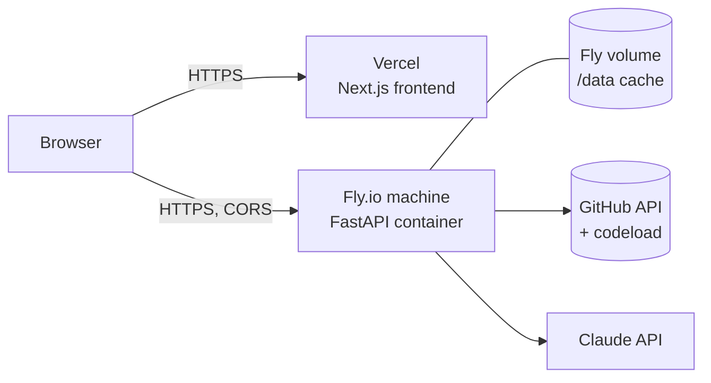

# Deploying GitVerse

Nothing here has been deployed. This guide, the Dockerfiles, `docker-compose.yml` and
`deploy/fly.toml.example` are prepared and tested locally; publishing needs the owner's go-ahead.

## What the system needs

| Part | Needs | Why |
| --- | --- | --- |
| Frontend (Next.js) | A Node.js host or a Next.js platform | Mostly static pages plus a small server |
| API (FastAPI) | **One** long-running process, about 1 GB of memory | Analysis jobs, the job list and rate limits live in memory; analyses run for seconds to minutes in the background, longer than serverless request limits suit |
| Storage | A small persistent disk (2 to 3 GB) | The result cache and AI Architect's evidence. Optional: without it, results are lost on restart and repositories are re-analyzed |
| Database | None | Results are immutable per commit and cached as files |
| Queue / workers | None | Jobs run in-process with bounded concurrency; parsing uses built-in worker processes |
| Secrets | Anthropic API key (optional), GitHub token (recommended) | Server-side only |

Analyses already run as background jobs: `POST /api/v1/analyses` returns at once with a job id,
and the browser polls `GET /api/v1/analyses/{id}`. No request waits for an analysis to finish, so
HTTP timeouts on hosting platforms don't apply to analysis time.

## Recommended setup



- **Frontend on Vercel's Hobby plan.** Free, with 100 GB of fast data transfer and 1,000,000
  function invocations a month, which is far more than a portfolio needs. Hobby is for
  personal, non-commercial use, which fits a portfolio project; a commercial deployment needs
  Pro.
- **API on one Fly.io machine with a volume.** A `shared-cpu-1x` machine with 1 GB costs
  $6.70 a month running continuously (Fly's pricing page, 30-day month), and a 3 GB volume $0.45.
  Fly has no free tier for new organizations: a new organization gets a one-time $1 trial credit,
  and a personal organization's bill under $5 a month is waived. A 512 MB machine ($3.69) with
  a 1 GB volume would fall under that, but leaves little memory for parsing large repositories:
  use `GITVERSE_PARSE_WORKERS=1` and lower the analysis limits if you try it. With
  `auto_stop_machines`, an idle machine stops and is billed only for its root file system.
- **Claude API** is billed per use. Without a key, AI Architect still works in evidence-only mode.

**Zero-cost alternative for the API: Render's free web service.** It runs the same Docker image,
but spins down after 15 minutes without traffic, takes about a minute to wake, has an ephemeral
file system (the cache is lost on every spin-down and deploy), cannot use a persistent disk, and is
limited to 750 instance hours a month per workspace. Render's page doesn't state the free
instance's memory, so check that large analyses fit before relying on it. Suitable for an
occasional demo, not for reliable use.

Prices and limits were read from the providers' own pages on 16 November 2026 and change often:
[Vercel Hobby](https://vercel.com/docs/plans/hobby),
[Vercel terms](https://vercel.com/terms) (Hobby is personal, non-commercial),
[Fly.io pricing](https://docs.fly.io/about/pricing),
[Fly.io request headers](https://docs.fly.io/networking/request-headers),
[Render free services](https://render.com/docs/free).

## Deploy the API to Fly.io

1. Install `flyctl` and sign in.
2. Copy `deploy/fly.toml.example` to `backend/fly.toml`. Set `app`, `primary_region` and
   `GITVERSE_CORS_ORIGINS` (the frontend's exact origin, with `https://`).
3. From `backend/`:

   ```bash
   fly launch --no-deploy --copy-config
   ```

   ```bash
   fly volumes create gitverse_data --size 3 --region <region>
   ```

   ```bash
   fly secrets set GITVERSE_GITHUB_TOKEN=<token with no scopes> GITVERSE_ANTHROPIC_API_KEY=<key>
   ```

   ```bash
   fly deploy
   ```

4. Check `https://<app>.fly.dev/health` returns `{"status":"ok",...}` and that `/docs` returns 404
   (docs are off in production).

Keep it to one machine (`fly scale count 1`): a second machine would have its own job list and
rate limits, and a browser polling one could be routed to the other.

## Deploy the frontend to Vercel

1. Import the GitHub repository in Vercel and set the **root directory** to `frontend`.
2. Add the environment variable `NEXT_PUBLIC_API_URL=https://<app>.fly.dev` for Production.
   It's compiled into the bundle, so redeploy after changing it, and never put a secret in it.
3. Deploy. The Content-Security-Policy only allows the browser to call that API origin.
4. Set the API's `GITVERSE_CORS_ORIGINS` to the Vercel URL (or your domain) and redeploy the API.

## Run the containers anywhere else

Both images are self-contained and run as unprivileged users.

```bash
docker build -t gitverse-api backend
```

```bash
docker build -t gitverse-web --build-arg NEXT_PUBLIC_API_URL=https://api.example.com frontend
```

The API image listens on 8000, keeps its cache in `/data` (mount a volume), and reads
configuration from environment variables (see `backend/.env.example`). The web image listens on
3000. Both have health checks. Run the API as a single replica. Put HTTPS in front of both.

## Production settings checklist

| Setting | Value |
| --- | --- |
| `GITVERSE_ENVIRONMENT` | `production` (set by the image) |
| `GITVERSE_CORS_ORIGINS` | The frontend's exact origin(s) |
| `GITVERSE_CLIENT_IP_HEADER` | The header your proxy overwrites with the client address (`Fly-Client-IP` on Fly.io), or empty if nothing sits in front of the API |
| `GITVERSE_GITHUB_TOKEN` | A token with no scopes, as a secret |
| `GITVERSE_ANTHROPIC_API_KEY` | As a secret, if AI explanations should be on |
| `GITVERSE_ARCHITECT_REQUESTS_PER_MINUTE` | Low enough to cap model spend per client |
| `GITVERSE_PARSE_WORKERS` | 1 or 2 on a 1 GB machine |
| `NEXT_PUBLIC_API_URL` | The API's public HTTPS origin, at frontend build time |

## Operating it

- **Logs:** the API logs to standard output (`GITVERSE_LOG_LEVEL`), uvicorn logs requests. No
  repository content or secrets are logged.
- **Health:** `GET /health` on the API, `GET /` on the frontend.
- **Shutdown:** the API stops gracefully on SIGTERM within 20 seconds: queued analyses are cancelled
  and parser processes stopped.
- **Disk:** caches stay within `GITVERSE_CACHE_MAX_MB` and `GITVERSE_EVIDENCE_MAX_MB`, least
  recently used first. Clearing `/data` is always safe.
